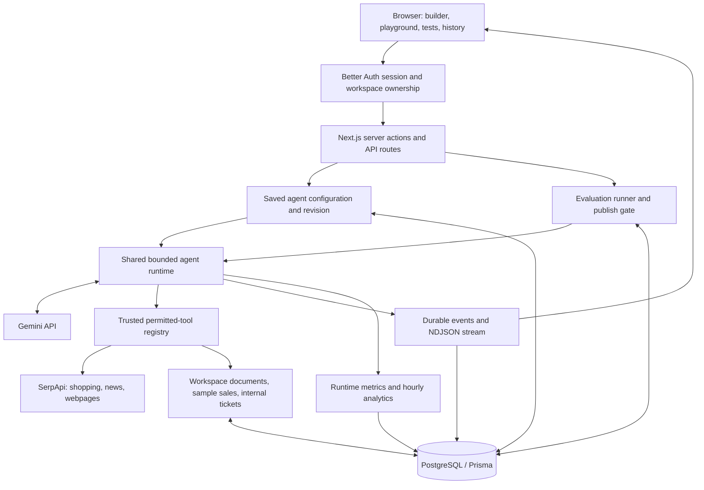

# Agent Depot

**Build, test, run, and inspect reusable AI agents from one workspace.**

Agent Depot—also called AgentForge in the original project plan—is a hackathon prototype for the platform behind an agent. Instead of writing a new backend for every assistant, configure its instructions, permitted tools, limits, and test cases. One shared Gemini runtime executes those configurations and records what happened.

The product follows one workflow:

**Configure → Save → Test → Publish → Run → Inspect → Revise**

Publishing identifies a tested revision. A saved agent can run in the playground before publication.

## Contents

- [What the application does](#what-the-application-does)
- [Tech stack](#tech-stack)
- [Architecture](#architecture)
- [Run locally](#run-locally)
- [Environment configuration](#environment-configuration)
- [Using the application](#using-the-application)
- [Tools and data](#tools-and-data)
- [Runtime and guardrails](#runtime-and-guardrails)
- [Evaluation and publishing](#evaluation-and-publishing)
- [Authentication and ownership](#authentication-and-ownership)
- [API reference](#api-reference)
- [Database and persistence](#database-and-persistence)
- [Repository structure](#repository-structure)
- [Development and verification](#development-and-verification)
- [Deployment and optional analytics](#deployment-and-optional-analytics)
- [Troubleshooting](#troubleshooting)
- [Current scope and limitations](#current-scope-and-limitations)
- [Further documentation](#further-documentation)

## What the application does

- **Agent builder:** create, edit, duplicate, and version saved configurations. Start with customer-support or competitor-pricing templates, or ask Gemini to propose an editable draft with assumptions and suggested tests.
- **Live playground:** execute a saved agent and watch model and tool events arrive. Reopen saved runs without rerunning the original prompt.
- **Evaluation Lab:** save expected tool calls, forbidden calls, required answer phrases, and optional semantic checks. Reuse the production runtime with writes denied during tests.
- **Release evidence:** publish only when the server finds passing evidence for the exact agent revision and current test definitions.
- **Run history and monitoring:** inspect final answers, inputs, tool outputs, statuses, errors, duration, token usage, and estimated model costs.
- **Workspace knowledge and tickets:** add private text documents for knowledge search and inspect internal support tickets created by an agent.
- **Personal workspaces:** email/password authentication, GitHub OAuth, and isolated guest sessions. Public browsing and form editing do not require an account.
- **Light/dark appearance:** a shared themed shell with a persisted preference. Theme initialization uses Next.js `Script` before hydration.

This is a working prototype with reliability and ownership controls, rather than a certification that an agent is ready for every enterprise workload. See [current scope](#current-scope-and-limitations) for verification boundaries.

## Tech stack

These are the technologies used by this repository, rather than the larger stack of a previous project:

- **Application:** Next.js 16.4, React 19.3, TypeScript, App Router, Server Components, and Route Handlers.
- **Bundler:** Turbopack for both development and production builds.
- **UI:** Tailwind CSS 4, custom React components, CSS theme tokens, SVG icons/charts, and Next.js font loading. Client state uses React hooks; the repo does not require Zustand or TanStack Query.
- **AI:** Vercel AI SDK 7 and `@ai-sdk/google` 4. The configured runtime profile is **`gemini-3.1-flash-lite`**. Agents store `model: "gemini"`; the server chooses the concrete model ID and pricing profile.
- **Validation:** Zod 4 for agent configuration, tool inputs, execution events, API requests, and evaluation definitions.
- **Database:** PostgreSQL 16, Prisma 7, `@prisma/adapter-pg`, and the Node PostgreSQL driver.
- **Authentication:** Better Auth 1.7.12 with its Prisma adapter, email/password, GitHub provider, and anonymous-user plugin.
- **Retrieval:** SerpApi for live shopping, news, and public-page extraction. Gemini handles reasoning over retrieved results.
- **Local infrastructure:** Docker Compose for PostgreSQL; an additional isolated Compose configuration for TimescaleDB tests.
- **Testing:** Vitest 5, TypeScript checks, ESLint, PostgreSQL integration tests, and explicit live smoke checks.
- **Deployment preparation:** a Dockerfile, production Compose configuration, and SSH/rsync deployment script for Vultr.
- **Optional analytics:** TimescaleDB hypertables and hourly aggregates, compatible with a configured Tiger Cloud PostgreSQL service. Hosted connectivity remains separately unverified.

No separate Python service, message queue, payment system, or external messaging provider is required.

## Architecture



### Request lifecycle

1. The server resolves a session and its workspace owner. It loads the saved agent under that owner.
2. The runtime snapshots the configuration and creates a durable run. Editing the agent later does not rewrite this snapshot.
3. The model receives the agent's instructions and currently executable permitted tool definitions.
4. The application validates and dispatches requested tool calls. The model does not receive an executor that can bypass application policy.
5. Tool results return to the model for further steps or a final response. Model/tool counts, active time, context size, and estimated cost bound the loop.
6. Events are persisted before delivery to the playground. Terminal state and the run's metric row are committed atomically.
7. History replays saved events. Evaluations use the same engine, with writes denied and results attached to the tested revision.

The UI uses the real HTTP client. Mock scenarios under `lib/fixtures/` and the mock run client support tests; they are not the production execution path.

## Run locally

### Prerequisites

- Node.js **22.12+**; Node 24 is recommended.
- npm and Git.
- Docker Desktop or Docker Engine with the Compose plugin, running before database setup.
- A Gemini API key for drafting, live execution, and semantic grading.
- A SerpApi key if using live shopping, news, or webpage tools.

### 1. Install and configure

From the repository root:

```bash
npm ci
cp .env.example .env
```

Copy the example only on a fresh checkout; preserve an existing `.env`.

Edit `.env` locally before continuing:

- Set `BETTER_AUTH_URL=http://localhost:3000`.
- Set a unique `BETTER_AUTH_SECRET` of at least 32 characters. Generate a value locally with `openssl rand -hex 32`.
- Set `GOOGLE_GENERATIVE_AI_API_KEY` for live AI features.
- Set `SERPAPI_API_KEY` for live retrieval.
- Keep the local database password and `DATABASE_URL` password consistent.
- Leave the supplied Gemini model and text-pricing settings together unless intentionally changing the supported model profile.

The example deliberately contains no authentication secret or provider key. Keep real credentials out of chat, Git, screenshots, and `NEXT_PUBLIC_*` variables.

### 2. Start PostgreSQL and prepare Prisma

```bash
npm run db:up
npm run db:generate
npm run db:deploy
npm run db:check
```

**PostgreSQL is the database server. Prisma is the ORM/client and migration CLI, not a second server to start.** Client generation and migration deployment are both required after pulling schema changes.

The default Compose project is `agent-depot`. PostgreSQL 16 listens on **`127.0.0.1:55433`** and keeps data in the `postgres_data` volume. If changing the host port, update both `POSTGRES_PORT` and `DATABASE_URL`.

### 3. Start the application

```bash
npm run dev
```

Open [http://localhost:3000](http://localhost:3000). Explore the public landing, tool catalog, and builder; use **Continue as guest** for a private demo workspace or create an account.

Optional CLI fixture setup:

```bash
npm run db:seed-demo
```

This preserves existing agents and adds the `support-demo` / `sales-demo` fixtures under the separate `demo` owner. It does **not** populate every newly signed-in or guest workspace. Use templates in the browser to create personal agents.

## Environment configuration

[`.env.example`](.env.example) is the local reference. Next.js reads the local environment; CLI scripts use `dotenv`. Keeping local values in `.env` makes both paths consistent. Restart the server after changing database targets or authentication settings, and after regenerating Prisma.

### Required application services

- `POSTGRES_PASSWORD`: initialization password for the local Compose database.
- `POSTGRES_PORT`: local host port; defaults to `55433` in Compose.
- `DATABASE_URL`: local/application PostgreSQL connection URL.
- `BETTER_AUTH_URL`: exact application origin. Production requires HTTPS.
- `BETTER_AUTH_SECRET`: stable server-only secret, at least 32 characters. Changing it affects existing auth/OAuth data.

### AI and retrieval

- `GOOGLE_GENERATIVE_AI_API_KEY`: server-only Gemini key.
- `RUNTIME_MODEL_ID`: concrete Gemini model; the current example uses `gemini-3.1-flash-lite`.
- `RUNTIME_INPUT_USD_PER_MILLION` and `RUNTIME_OUTPUT_USD_PER_MILLION`: positive text-pricing estimates used by runtime budgets. Recheck pricing when changing model or service tier; these estimates are not invoices.
- `SERPAPI_API_KEY`: enables live shopping/news/extraction. Missing setup is shown in the tool picker and playground; unavailable tools are excluded from Gemini's usable tool declarations.

### Optional features

- `GITHUB_CLIENT_ID` and `GITHUB_CLIENT_SECRET`: enable GitHub sign-in together. For local OAuth, set Homepage URL to `http://localhost:3000` and callback URL to `http://localhost:3000/api/auth/callback/github`.
- `DATABASE_TARGET`: `local` by default; `tiger` selects `TIGER_DATABASE_URL` for the entire application and Prisma CLI.
- `TIGER_DATABASE_URL`: hosted PostgreSQL URL, used only when the Tiger target is selected.
- `RUNTIME_METRICS_BACKEND`: `postgres` by default; `timescale` requires the additional metrics SQL setup.
- `TIMESCALE_TEST_PORT`: isolated TimescaleDB test port; defaults to `55434`.
- `RUNTIME_ALLOW_DEMO_TOKEN` and `RUNTIME_API_TOKEN`: explicit local-only compatibility for selected runtime routes and the `demo` owner. Browser sessions do not need a bearer token. Leave this compatibility mode off for normal use; it is rejected in production.

Selecting another database does not copy data between services. The Tiger selector is not an independent analytics sink or automatic failover mechanism.

## Using the application

1. **Explore:** open the landing, tool catalog, or a starter template without signing in.
2. **Configure:** edit the workspace name, agent name, instructions, allowed tools, and limits. Template names use the guest/account/company identity rather than a hardcoded business.
3. **Save:** authentication opens only when a protected action needs it. Embedded sign-in preserves the filled form. Save again after authentication to create the agent.
4. **Review tests:** templates include three suggested checks. Saving/restoring an agent requests its saved suite when cases exist. Open Tests for results and traces; API clients can request evaluation separately.
5. **Run:** send a request in Playground. Read the final answer and execution trace. A support ticket creates immediately and links to its saved location in Tools & knowledge.
6. **Inspect:** use Runs for history, inputs/outputs, safe failure reasons, and usage estimates. A saved playground URL replays the original run.
7. **Revise:** save a new version, duplicate an agent, or restore an earlier configuration as a new revision. Inspect YAML in the builder or Versions tab.
8. **Publish:** after the current revision and test definitions have passing evidence, mark that revision as released.

### Screens and navigation

- `/`: public introduction when signed out; private agent dashboard when signed in.
- `/agents/new`: public configuration form and starter templates.
- `/agents/[id]`: private saved-agent editor.
- `/agents/[id]/playground`: live execution and saved-run replay.
- `/agents/[id]/tests`: saved checks, evaluation results, and publication controls.
- `/agents/[id]/versions`: configuration history and restore.
- `/playground` and `/tests`: workspace agent pickers.
- `/runs` and `/runs/[runId]`: private run list and detail.
- `/tools`: public tool descriptions; signed-in document management and internal ticket records.
- `/auth`: compatibility redirect to the public landing; authentication is displayed in dialogs. GitHub failure returns use `/?authError=1` to show retry guidance.

## Tools and data

Tool IDs remain stable across the builder, runtime, tests, and saved configurations.

- **`knowledge_search` — Search workspace knowledge:** keyword search over the owner's uploaded text documents. With no uploads, it returns clearly labeled sample policies. Once private documents exist, it excludes sample-policy fallback. This is lightweight text search, not embedding/vector retrieval.
- **`sales_lookup` — Explore sample sales:** queries a prepared illustrative product dataset. It is not connected to a real merchant's revenue or inventory.
- **`google_shopping` — Compare competitor prices:** retrieves up to five SerpApi shopping results with prices, sellers, and available product links.
- **`google_news` — Search recent news:** retrieves up to five SerpApi news results with available titles, snippets, dates, and links.
- **`read_webpage` — Read a public webpage:** requests SerpApi extraction and returns at most 4,000 characters of text. It is not a general browser or authenticated-page connector.
- **`create_ticket` — Create a support ticket:** persists an internal owner-scoped request with a strict output schema and idempotency key. It creates immediately, including on older agents with write review enabled. It does not issue a refund, send mail, or create an external helpdesk ticket.

Email delivery was removed. Historical `send_email` IDs and records remain recognizable for old agents/history, but the tool is hidden from new selections and cannot execute. Saving an old agent through the builder removes the retired selection. Slack, Discord, and Brevo integrations are not implemented.

### Retrieval quality

SerpApi responses are cached locally for five minutes; provider error responses are not cached. Some direct integration fixtures remain for deterministic demos/tests and identify themselves as sample data. They are not proof that live retrieval occurred.

A lower listed price does not establish a better equivalent offer. Check package weight, product formulation, seller, shipping, currency, availability, and offer date. Missing fields remain missing; the platform should not invent them. Uploaded knowledge is a source for answers, not trusted execution instructions.

## Runtime and guardrails

The shared entry point is `runAgent()` in [`lib/agents/runtime/run-agent.ts`](lib/agents/runtime/run-agent.ts). Routes resolve owner/configuration server-side; run requests supply a message, not replacement tool permissions or limits.

Default limits from the shared contract:

- Five model calls and ten tool calls per run.
- Two write actions per run, with a schema maximum of five.
- An estimated model-cost cap of $0.05.
- 512 output tokens per model call.
- 30 seconds of active runtime across resumptions; time waiting for review is not active execution time.
- Bounded prompt/context serialization and a maximum 32 KiB serialized tool result.

Limits are configurable within schema maxima. Estimated model costs do not include a guarantee about provider invoices, SerpApi subscription charges, or hosting costs. Missing usage stays **unknown**, never automatically zero. Model requests do not automatically retry billable work.

### Trusted tool interface

[`lib/agents/tools/registry.ts`](lib/agents/tools/registry.ts) defines the interface: stable ID, description, read/write classification, Zod input schema, optional output schema, availability/policy metadata, and `run(input, context)`. Context supplies verified ownership, run/call IDs, an idempotency key, and cancellation.

To add a tool:

1. Implement and validate its behavior under `lib/integrations/`.
2. Register the trusted adapter in `runtime-tools.ts`; keep availability and write behavior explicit.
3. Update browser-safe evaluation IDs when adding a testable tool.
4. Add meaningful contract/runtime tests, including failure and ownership cases.
5. Confirm the builder catalog and descriptions match actual execution behavior.

Do not let a model or client body provide executor code, credentials, ownership, or authorization rules.

### Approval support

The engine retains durable pause/approve/reject/resume infrastructure for reviewed write tools and historical runs. An approval applies only to its exact stored arguments; claims are single-use and expiry/ownership are checked before resumption. Evaluation runs deny writes rather than asking for approval.

The current internal ticket tool is explicitly exempt from human review. No current tool sends external communications. A generic write-policy option does not mean every tool is locked until approval or publication.

## Evaluation and publishing

Saved cases can assert:

- Tools that must be requested.
- Tools that must not be requested.
- Phrases that must appear in the answer.
- Optional Gemini grading against instructions, tool evidence, and expected behavior.

The runner snapshots one to five saved cases and the agent version. It serializes concurrent suites and bounds suite duration and estimated model/grading cost. Tests execute through the same runtime with writes auto-denied; they do not create actual tickets.

A publication check uses server-side persisted evidence for the exact revision and a fingerprint of current test definitions. Editing tests invalidates older evidence. Saving or restoring creates a new revision that needs its own checks. A client-supplied `testsPassed` value cannot bypass this gate.

Provider unavailability is different from an agent producing the wrong answer. Inspect individual run traces when evaluations fail before tool calls. Passing these saved checks is useful release evidence, not a comprehensive enterprise-readiness guarantee.

## Authentication and ownership

Better Auth uses PostgreSQL-backed users, sessions, accounts, and verification records. Email/password, optional GitHub OAuth, and anonymous guest sessions share the workspace boundary.

- Each guest gets an isolated workspace. Signing out ends access to that guest session; it is not a shared public demo account.
- Private agent/run/document/ticket access is resolved from the verified session owner.
- Mutation routes validate the expected application origin; APIs enforce their own authorization independently of visible buttons.
- OAuth tokens are encrypted at rest by the auth library configuration. Keep the authentication secret stable and private.
- Public promotion, builder previews, and tool metadata do not expose private workspace data.
- No browser bearer token is needed for normal same-origin execution.

See [authentication implementation](docs/auth-README.md) for provider setup and deployment-specific checks.

## API reference

Unless noted, routes require a Better Auth session. Browser requests use same-origin cookies; state-changing requests must come from the configured origin. The owner is never selected by a client request field. Route-specific schemas/status codes are authoritative in source.

### Agents and versions

```text
GET    /api/agents                         List workspace agents
POST   /api/agents                         Create an agent
GET    /api/agents/:id                     Read agent/configuration/version summaries
PUT    /api/agents/:id                     Save a new configuration revision
DELETE /api/agents/:id                     Delete an agent
POST   /api/agents/:id/duplicate           Duplicate configuration and saved case definitions
GET    /api/agents/:id/versions            List saved revisions
POST   /api/agents/:id/rollback            Restore a revision as a new version
POST   /api/agents/:id/publish             Publish after server-side evidence checks
GET    /api/agents/:id/publish-status      Check release eligibility; optional ?version=
```

Use **PUT**, not PATCH, for agent configuration updates. Example create/update body:

```json
{
  "name": "Store Support",
  "workspaceName": "My Store",
  "model": "gemini",
  "instructions": "Use workspace knowledge for policy answers. Create an internal ticket when explicitly requested. Do not invent policy.",
  "enabledTools": ["knowledge_search", "create_ticket"],
  "requireWriteApproval": false,
  "limits": {
    "maxModelCalls": 5,
    "maxToolCalls": 10,
    "maxWriteCalls": 2,
    "maxEstimatedCostUsd": 0.05
  }
}
```

The server generates IDs, ownership, and revision numbers. Optional `testCases` can accompany configuration input. Duplicate requests need no configuration body; rollback accepts `{ "version": 1 }`; publish accepts `{}` and verifies evidence itself.

### Drafting, execution, and review

```text
POST /api/agents/draft           { "goal": "Describe the agent's job" }
POST /api/agents/:id/run         { "message": "The user's request" }
POST /api/approvals/:id          { "approved": true } or { "approved": false }
```

Drafting returns a proposed spec plus usage metadata; it does not save or publish an agent. Execution and review return **newline-delimited JSON (NDJSON)** with `Content-Type: application/x-ndjson`, rather than a single final JSON document.

Each event contains `schemaVersion`, `eventId`, `runId`, increasing `sequence`, ISO `timestamp`, `type`, and a typed `payload`. Events include model/tool start and finish, tool failures, approval requests/decisions, and terminal completion/block/failure. They describe execution evidence, not private model reasoning.

HTTP 200 means the stream started, not that the run succeeded. Read the terminal event. Clients must buffer partial lines because network chunks can split JSON. Use [`readRunStream`](lib/playground/ndjson.ts) and the [HTTP client](lib/playground/http-client.ts) as the reference implementation. Reopen an approval through its review endpoint; do not resend the original prompt to resume it.

### Tests and history

```text
GET    /api/agents/:id/tests          List saved test cases
POST   /api/agents/:id/tests          Create a test case
PATCH  /api/tests/:id                 Update selected test-case fields
DELETE /api/tests/:id                 Delete a test case
POST   /api/agents/:id/tests/run      Run the saved suite; JSON body {}
GET    /api/runs                      Paginated workspace run history
GET    /api/runs/:id                  Run detail, ordered events, approvals
GET    /api/runs/:id?after=SEQUENCE   Incremental execution-event replay
```

Run-list filters include `agentId`, `status`, `source`, `limit`, and `cursor`. `source` defaults to `playground`; use `test` for evaluation runs. The default page size is 50, maximum 100. Follow the returned pagination state rather than treating one page as all history.

### Knowledge, sample data, and metrics

```text
GET    /api/knowledge                 Owner's documents plus sample-document metadata
POST   /api/knowledge                 { "title": "Returns", "text": "Policy text" }
DELETE /api/knowledge/:id             Delete an owned document
GET    /api/datasets                  Prepared sample products
GET    /api/datasets/sales            Labeled sample-sales dataset
GET    /api/runtime/metrics           Hourly runtime aggregates
```

Metrics require ISO UTC `from` and `to` query parameters on exact hour boundaries; `to` is later than `from`, with a maximum 31-day window. Optional `agentId` filters the report. The API resolves the owner and backend server-side.

### Authentication and retired endpoints

- `GET` / `POST /api/auth/*`: delegated to Better Auth, including session/authentication operations and the GitHub callback at `/api/auth/callback/github`.
- `POST /api/dev/tools`: intentionally returns **410**; direct invocation would bypass runtime permission and policy checks.

Common errors include invalid input/query (400), missing/invalid session (401), origin/permission rejection (403), inaccessible records (404), and reused/expired reviews or missing publish evidence (409). Server/configuration/provider failures are mapped according to the route. After streaming begins, errors are represented by run events and safe stop reasons; inspect those as well as the HTTP response.

## Database and persistence

The Prisma schema is [`prisma/schema.prisma`](prisma/schema.prisma); migration history is committed under `prisma/migrations/`. `prisma.config.ts` resolves the same database selector used by the application.

Main records:

- **User, Session, Account, Verification:** Better Auth identity and session state.
- **Agent / AgentVersion:** current owner-scoped configuration and append-only saved revisions.
- **AgentRun:** configuration snapshot, tested/executed agent version, source, status, answer, usage/checkpoint state, and timestamps.
- **RunEvent:** durable ordered execution records, unique by event ID and run/sequence pair.
- **Approval:** exact proposed action, expiration, and single recorded decision.
- **RuntimeMetric:** one terminal metric record per finished run, with nullable usage and estimated cost.
- **KnowledgeDocument:** private searchable workspace text.
- **DemoTicket:** internal support requests with durable call idempotency.
- **TestCase / TestRun:** saved definitions and revision-specific execution evidence.
- **RecordedEmail:** historical records retained for compatibility; no current delivery/execution capability.

Run snapshots retain historical context independently of later agent changes or deletion. Checkpoints remain server-only and are excluded from browser history responses. Atomic storage operations handle event sequencing, checkpoint versions, approval claims, and terminal metrics.

### Database commands

```bash
npm run db:up
npm run db:status
npm run db:generate
npm run db:deploy
npm run db:migrate -- --name describe_change
npm run db:studio
npm run db:check
npm run db:down
```

`db:down` stops containers while preserving volumes. Deleting the PostgreSQL volume erases its data. Initialization passwords apply when a volume is first created; editing `.env` alone does not rotate an existing database password.

Coordinate schema ownership across branches. Commit a schema change and its migration together; regenerate the client and deploy migrations after pulling. Do not commit generated Prisma output or real environments.

## Repository structure

```text
app/
  page.tsx                     Public landing or signed-in dashboard
  dashboard.tsx                Workspace agent library and recent activity
  layout.tsx                   Fonts, theme initialization, navigation
  agents/
    new/                       Public new-agent form
    [id]/                      Saved-agent editor
    _components/               Builder and browser API helpers
    actions.ts                 Authenticated Gemini draft action
  (workspace)/                 Route group; does not appear in URLs
    agents/[id]/               Playground, tests, versions, shared header
    runs/                      Run list and detail
    tools/                     Catalog, knowledge, internal ticket records
    playground/, tests/        Agent pickers
  api/                         Route handlers listed above
  auth/                        Auth form and compatibility redirect
components/
  auth/, marketing/            Landing, dialogs, account/session controls
  playground/, trace/          Chat, event timeline, review and output views
  runs/, tests/, shell/         Monitoring, evaluations, navigation/version UI
  ui/                          Shared controls, themes, icons, fonts
lib/
  agents/contracts/            Zod/TypeScript configuration and event contracts
  agents/library/              Agent persistence, revisions, catalog, YAML
  agents/runtime/              Model adapter, loop, cancellation, HTTP, drafting
  agents/storage/              Prisma run store and metric queries
  agents/tools/                Trusted registry and dispatcher
  auth*, auth/                 Better Auth server/client and owner resolution
  db/                          Prisma client and local/Tiger connection selection
  integrations/                Executable tools, SerpApi, prepared sample data
  evals/                       Assertions, grader, runner, evidence/publish gate
  playground/                  NDJSON transport and event reduction
  runs/                        Owner-scoped history and display metrics
  fixtures/                    Explicit test/demo scenarios
prisma/                        Schema and migrations
scripts/                       Database, diagnostics, smoke and deployment helpers
docs/                          Focused implementation and deployment guides
compose.yaml                   Local PostgreSQL
compose.timescale-test.yaml    Isolated TimescaleDB test database
compose.prod.yaml              Production deployment starting point
Dockerfile                     Container build/runtime definition
```

## Development and verification

```bash
npm test                       # Deterministic unit/contract/transport tests
npm run test:integration        # PostgreSQL-backed behavior and HTTP tests
npm run typecheck              # next typegen, then tsc --noEmit
npm run lint
npm run build                  # Default Turbopack production build
```

Start/migrate the local database before integration tests. They exercise authentication, ownership, configuration history, runtime dispatch, budgets, approvals, idempotency, evaluation, publication, and metrics using test-created records. Provider responses are simulated where a deterministic assertion is needed; these tests are not live Gemini, GitHub, or Tiger Cloud verification.

The last recorded full regression verification passed **118 unit tests and 64 PostgreSQL integration tests**, plus typecheck, lint, and the default production build. Counts change as coverage evolves; command output is the current source of truth.

### Live checks

- Use the browser to verify provider-dependent flows, saved history, and the auth-at-action boundary with disposable test data.
- `npm run db:diagnose` reports selected-database DNS/TCP/PostgreSQL SSL/TLS stages without authenticating or printing credentials.
- `npm run metrics:check` compares the configured metrics path with stored data; zero finished runs does not establish ingestion.
- `npm run runtime:smoke -- --live` is an opt-in real-Gemini script. **Its legacy ticket-review assertions predate immediate ticket creation; review/update those expectations before treating it as a current release gate.** It is not part of the deterministic test suite.
- Optional isolated analytics tests use `npm run metrics:test:up`, `npm run test:timescale`, and `npm run metrics:test:down`. Read [metrics setup](docs/runtime-metrics.md) before using them.

### Collaboration

Keep changes in focused branches, preserve teammates' local edits, and integrate working slices early. Shared contracts, schema/migrations, and the root layout are integration-sensitive. Test public and private paths after navigation/auth/style changes, not only a signed-in dashboard. The project-local `AGENTS.md` requires reading the installed Next.js guides before implementation changes because this version differs from older releases.

## Deployment and optional analytics

### Local production server

After configuring the database and environment:

```bash
npm run db:generate
npm run db:deploy
npm run build
npm start
```

Production authentication requires an HTTPS `BETTER_AUTH_URL`, correct public origin, valid secrets, and matching GitHub callbacks. Serve production traffic behind TLS termination. Building locally does not verify deployed cookies, streaming, database access, or OAuth consent.

### Vultr

The repository includes deployment preparation in [`Dockerfile`](Dockerfile), [`compose.prod.yaml`](compose.prod.yaml), [`scripts/deploy-vultr.sh`](scripts/deploy-vultr.sh), and the [Vultr guide](docs/vultr.md).

The script deploys over SSH/rsync to an existing host; it does not provision a Vultr server or require a Vultr API key. Its intended entry point is:

```bash
VULTR_HOST=user@YOUR_VULTR_IP npm run deploy:vultr
```

**These files are a starting point, not a verified production deployment.** The production Compose environment and `.env.vultr.example` predate the current auth/search configuration. Before deploying:

- Provision a host, Docker/Compose, SSH access, and a public HTTPS origin.
- Wire `BETTER_AUTH_URL`, `BETTER_AUTH_SECRET`, optional GitHub credentials, and `SERPAPI_API_KEY` into the app container, alongside database/model settings. Adding a value to `.env.production` alone does not inject it unless Compose forwards it.
- Forward database-target/analytics settings explicitly if using Tiger/Timescale instead of the supplied PostgreSQL service.
- Review the script's `rsync --delete` behavior and exclusions. Private local notes/caches must not be uploaded; ignored local files are not automatically excluded by rsync.
- Verify container build, committed migrations, session cookies, owner isolation, OAuth, and unbuffered NDJSON streaming on the real host.

No successful live Vultr deployment has been verified in the recorded checks. Do not describe deployment templates alone as demonstrated cloud hosting.

### Tiger Cloud / TimescaleDB

Local PostgreSQL already stores terminal runtime metrics and serves hourly aggregates. Optional SQL setup enables TimescaleDB hypertables and a continuous aggregate.

To target a hosted Tiger service, configure `TIGER_DATABASE_URL` and set `DATABASE_TARGET=tiger` in the relevant server/CLI environment. Apply schema migrations and the separate metrics setup on that selected database; set `RUNTIME_METRICS_BACKEND=timescale` only after setup succeeds. Follow the [metrics guide](docs/runtime-metrics.md) for commands and TLS details.

The current selector moves the **whole application database**, not only analytics. Local PostgreSQL remains available by selecting `local`; there is no silent automatic fallback. Prefer verified TLS/hostname validation, and never disable verification globally.

Recorded hosted probes resolve DNS but time out at TCP, before TLS/authentication. Console `SELECT 1` confirms internal service SQL, not application connectivity. **Hosted application writes/reads and analytics remain unverified.** Local TimescaleDB tests establish extension compatibility only.

## Troubleshooting

### Missing Prisma models or database relations

Run `npm run db:generate` and `npm run db:deploy`, confirm `db:status`, then restart the dev server. Regeneration alone does not apply database migrations.

### Login or guest access is unavailable

Check `BETTER_AUTH_URL`, a secret of at least 32 characters, database health/migrations, and the exact configured origin. GitHub needs both provider credentials and the correct callback. A fresh guest workspace is expected to be empty; CLI demo seeds belong to a different owner.

### Shopping/news/webpage tools are unavailable

Set `SERPAPI_API_KEY` in the app's server environment. Tools & knowledge should show it as configured; check provider access/quota if calls fail. Gemini uses a separate key. Cached results, empty results, and provider failures are different outcomes.

### Gemini fails even after rotating the key

Inspect the saved run's reason. Access errors, quota errors, bad requests, timeouts, and provider unavailability require different responses. A fresh API key does not resolve overloaded model capacity.

The latest recorded independent REST and runtime probes of `gemini-3.1-flash-lite` received HTTP 503 / `UNAVAILABLE` with Google's high-demand message; a minimal SDK probe timed out. Earlier live runs succeeded. This is a dated observation, not a permanent status assertion. Keep the configured model unless intentionally choosing and verifying another supported profile; do not silently change models or reuse incompatible pricing. See [runtime diagnostics](docs/runtime-README.md).

### A run has failed, but a ticket exists

A later model failure does not roll back an already completed tool write. The playground reports completed ticket actions and links to records. Check before starting another run; a new run can represent a new ticket request.

### A test fails or publishing is blocked

Open that test's trace. Check provider availability, tool permissions, required phrases, and whether the evidence matches the current revision/test definitions. A styling change does not create passing evidence, and a client flag cannot override the publish gate.

### Theme or generated-build errors after a merge

The saved theme uses Next.js `Script` with `beforeInteractive`. Do not replace it with a raw script rendered by React during client navigation. If generated Prisma or `.next` output is stale, stop the dev server, preserve/clear only the relevant generated cache, and restart. Keep Turbopack as the default bundler; a sandbox port-denial error is not proof that the application needs Webpack.

## Current scope and limitations

**Implemented and exercised locally:** reusable agent configuration, version history, private workspaces, live event streaming, tool dispatch, immediate internal tickets, saved runs, evaluation/release evidence, local metrics, public onboarding, and theme persistence.

**Live retrieval verified:** shopping and news returned fresh results with links, public-page extraction succeeded, and a saved agent completed a Gemini → shopping → final-answer run. Product-size equivalence and answer quality still need review.

**External checks remain separate:** current Gemini capacity recovery, interactive live GitHub OAuth/provider consent, hosted Tiger application ingestion/analytics, and a full Vultr deployment. A passing local build or simulated-provider test does not establish any of these.

**Not implemented:** Stripe/subscriptions/billing, Nessie, external email/Slack/Discord delivery, external ticketing, general multi-provider model selection, vector/embedding RAG, a visual workflow editor, or autonomous multi-agent orchestration. Knowledge ingestion currently accepts text rather than a complete file-upload/extraction pipeline.

For production, further work includes verified deployment configuration, durable job execution/recovery across infrastructure failures, per-user quota/billing policy, broader evaluation coverage, retention/backup procedures, and operational alerting. Do not market the hackathon prototype as a complete enterprise security/compliance solution.

## Further documentation

- [Application integration](docs/integration-README.md): connected screens, behavior, regression and live-verification notes.
- [Agent Runtime Engine](docs/runtime-README.md): execution loop, contracts, persistence, APIs, cancellation, decisions, and diagnostics.
- [Authentication and workspaces](docs/auth-README.md): Better Auth, GitHub setup, guest isolation, session/origin boundaries.
- [Internal actions and tool availability](docs/guarded-actions.md): immediate tickets, retired email, retrieval requirements, failure recovery.
- [Runtime metrics](docs/runtime-metrics.md): PostgreSQL/Timescale queries, hourly API contracts, Tiger configuration, isolated tests.
- [Vultr deployment guide](docs/vultr.md): existing deployment scaffolding; use the production caveats in this README when following older examples.

There is no repository license file at the time of this documentation update. Confirm licensing before distributing the project under an assumed open-source license.
